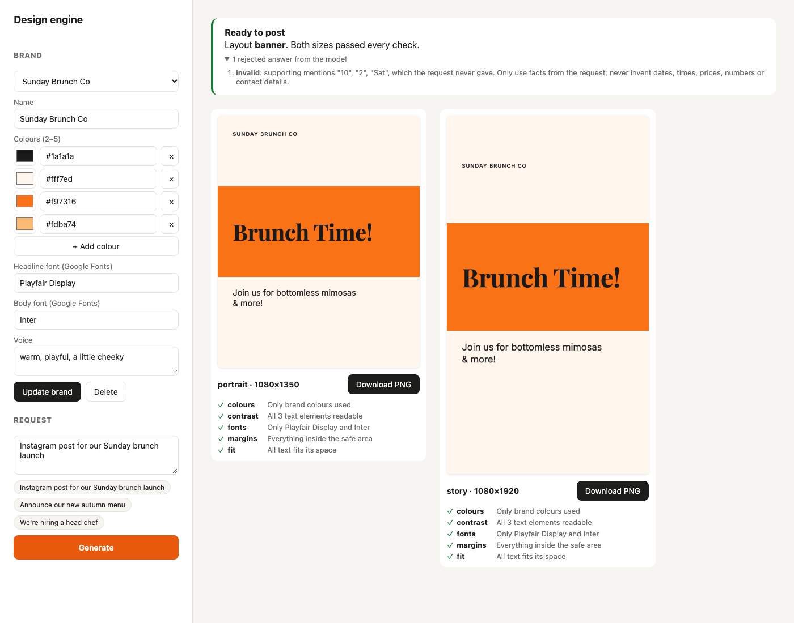
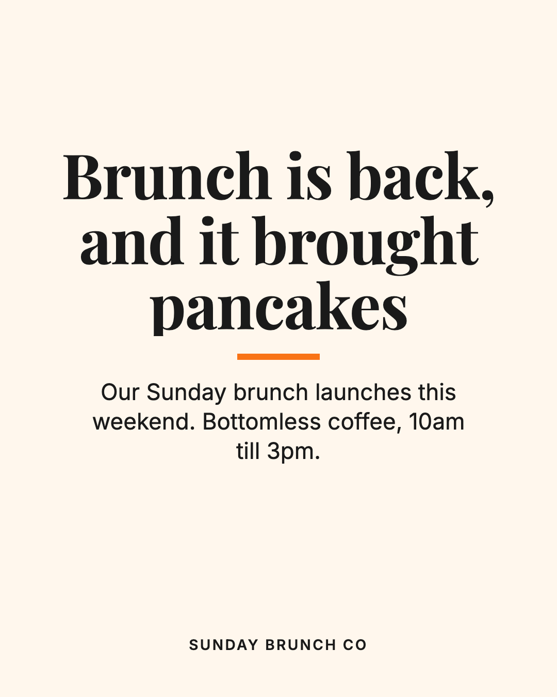
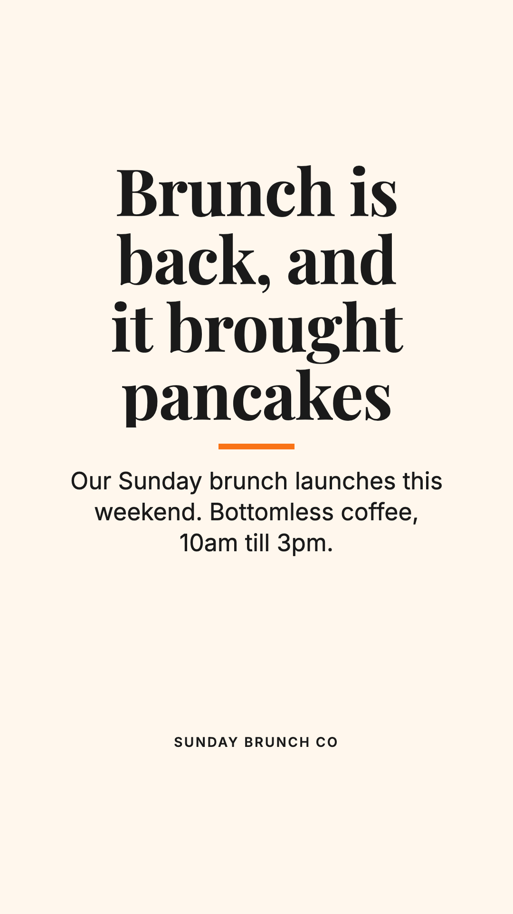
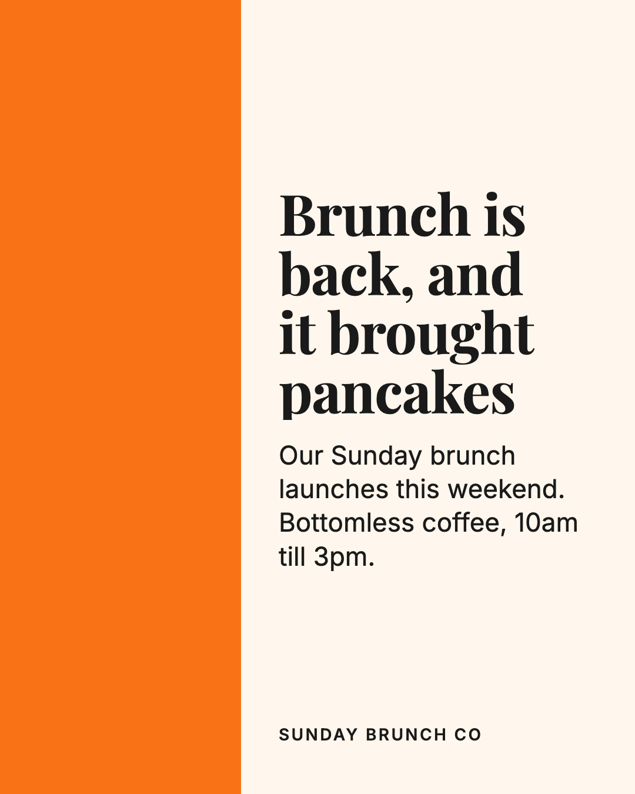
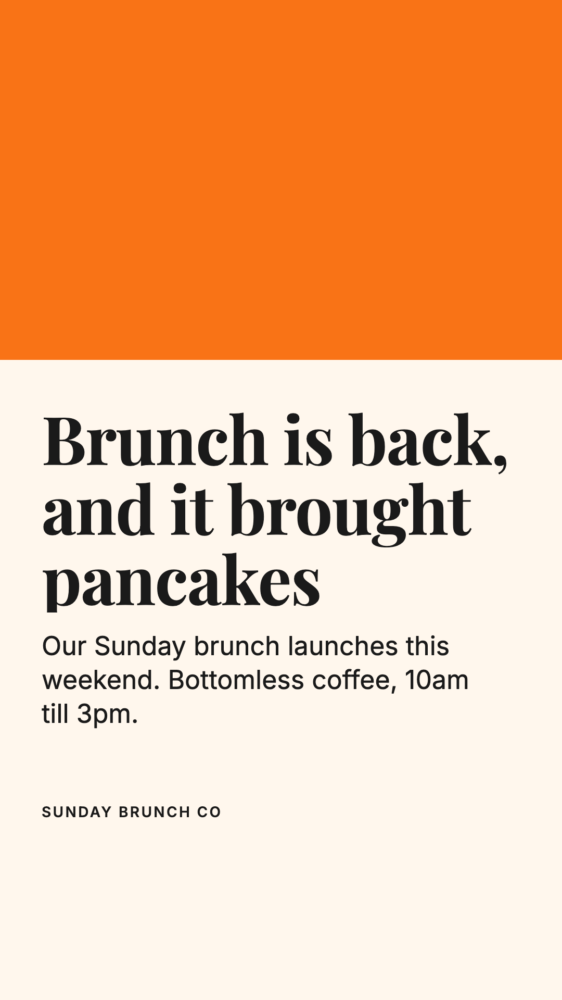
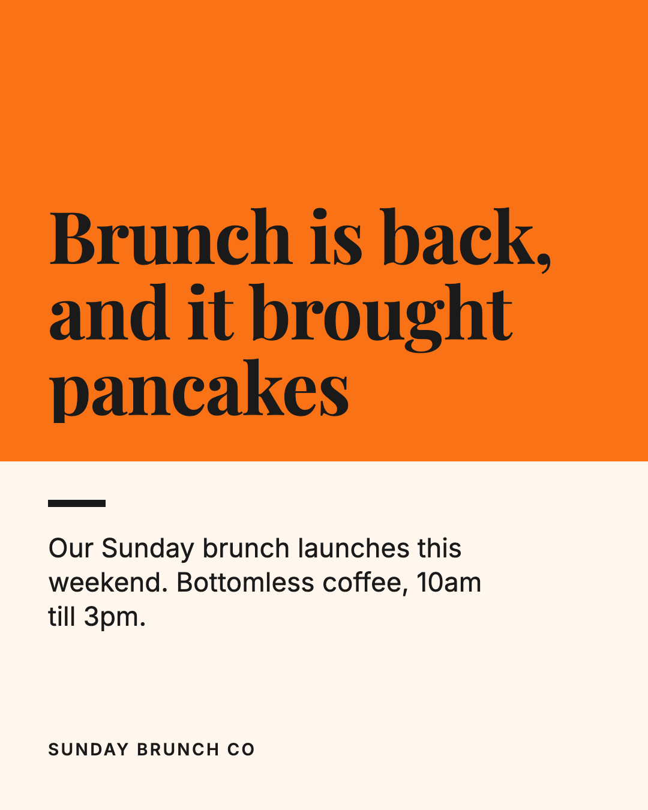
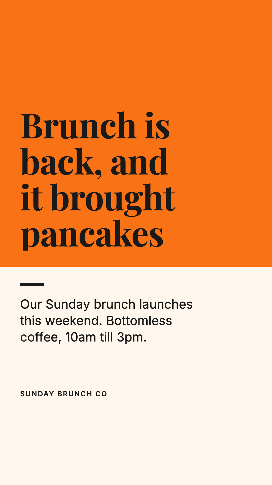

# Pacey design engine

Turns a brand and a one-line request into an on-brand social graphic at two sizes, using an open-source model running locally through Ollama.

**The model plans the design. The code does everything else:** checking the plan, laying it out, rendering, and auditing the result against the brand.



*Real run with `qwen2.5:7b`. The model's first answer invented "Sat", "10" and "2" for a request that gave no day or time. It was rejected with that reason, and the repaired plan passed.*

## Run it

You need Node 22+ and [Ollama](https://ollama.com).

```bash
brew install ollama && brew services start ollama
ollama pull qwen2.5:7b            # or qwen2.5:3b on a slower machine

npm install
npx playwright install chromium   # headless browser used for rendering
npm run dev                       # API on :3001, UI on http://localhost:5173
```

The first render of a brand downloads its Google Fonts into `.cache/fonts/`. After that, rendering works offline.

| Command | What it does |
| --- | --- |
| `npm run dev` | API and UI together. Ctrl-C stops both. |
| `npm test` | Unit and end-to-end tests. The model is faked, rendering is real. |
| `npm run plan -- "<request>"` | Asks the real model for one plan and prints every rejected attempt. |
| `npm run preview` | Renders all 3 layouts at both sizes to `.cache/preview/` and prints the brand check. |
| `npm run typecheck` | `tsc --noEmit` |

Environment variables: `OLLAMA_MODEL` (default `qwen2.5:7b`), `OLLAMA_URL` (default `http://localhost:11434`), `PORT` (default `3001`), `BRANDS_FILE` (default `data/brands.json`).

## How it works

```
Brand + request
  → model.ts     Ollama returns a plan (JSON), constrained to this brand's colours and fonts
  → validate.ts  shape + brand rules; on failure the reasons go back to the model (repair loop)
  → layouts.ts   the plan picks 1 of 3 code-built layouts; pure function plan → HTML per size
  → render.ts    Chromium loads it, checks the fonts really loaded, shrinks text to fit, screenshots
  → check.ts     brand check on the rendered page, pass/fail per rule
  → pipeline.ts  ties it together for both sizes; index.ts serves it; web/ is the UI
```

Each stage is its own module with one job. The model never writes markup, layouts never call the model, and the check reads what Chromium actually drew rather than what the plan says.

| File | Job |
| --- | --- |
| `server/schema.ts` | `Brand` and `Plan` zod schemas. The field descriptions double as instructions to the model. |
| `server/model.ts` | Prompt, Ollama call, JSON extraction, repair loop (`generatePlan`) |
| `server/validate.ts` | `validatePlan`: shape, palette, fonts, contrast. Every reason is a sentence the model can act on. |
| `server/layouts.ts` | 3 layouts × 2 sizes, safe areas, HTML escaping |
| `server/fonts.ts` | Fetches a Google Font and inlines it as a data URI, cached on disk |
| `server/render.ts` | Playwright: font loading, shrink-to-fit, screenshot |
| `server/check.ts` | `collectFacts` (in the browser) + `checkFacts` (pure rules) |
| `server/pipeline.ts` | `generateDesign`: plan → both sizes → checks |
| `server/brands.ts` | Saved brands in a JSON file |
| `server/index.ts` | Express API |
| `web/App.tsx` | The UI |

Domain terms (Brand, Plan, Layout, Size, Design, Brand check, Repair) are defined in [CONTEXT.md](CONTEXT.md).

## The plan schema

The model answers with exactly this. Nothing else from the model reaches the page.

```json
{
  "layout": "centered | split | banner",
  "headline": "≤ 60 chars",
  "supporting": "≤ 120 chars",
  "colors": { "background": "#hex", "text": "#hex", "accent": "#hex" },
  "fontRoles": { "headline": "<brand font>", "body": "<brand font>" }
}
```

- **layout:** which of the three code-built layouts to fill. The prompt describes each layout in one line. qwen2.5:7b stuck to a favourite layout (see "Layouts chosen" below), so each request offers a random 2 of the 3 and the model picks between them. With all three hints equally broad, 9 real requests gave centered 5, split 2, banner 2.
- **colors:** role assignment. Each value must be one of the brand's colours. `text` on `background` must reach 4.5:1, and `accent` must differ from `background`.
- **fontRoles:** which brand font is used where.

The brand name is drawn from the brand, not the plan, so the model can't misspell it.

The same zod schema is used three ways:

1. **Sent to Ollama:** it goes in the `format` field as JSON Schema, narrowed per brand so the colour and font fields become enums.
2. **Shown to the model:** it's printed in the system prompt.
3. **Run on the answer:** it validates whatever comes back.

## How bad output is handled

The goal is that a weak model's mistakes never reach the screen. The defence is layered, from cheapest to most thorough:

1. **Constrained decoding.** Ollama gets a JSON Schema with this brand's colours and fonts as enums, so in most cases the model can't even produce an off-brand value.
2. **Tolerant parsing.** If the JSON is wrapped in prose or code fences, the outermost `{…}` is extracted.
3. **Validation with reasons.** zod checks the shape, then brand and content rules. Each failure is written as a plain sentence the model can act on, e.g. *"text #fdba74 on background #f97316 has contrast 1.62:1; need at least 4.5:1. Pick a text colour that differs more in lightness."* The rules:
   - **Brand:** palette, fonts, contrast, accent ≠ background.
   - **Drawable text:** only characters the brand fonts can draw, so no emoji and no other scripts.
   - **No invented facts:** every number, weekday, email or URL in the copy must appear in the request or brand name.
4. **Repair loop.** The model's answer and a repair message listing those reasons are added to the same conversation, and it tries again: **at most twice**, so at most 3 calls, whatever went wrong. Each attempt is labelled `malformed` (not JSON, or the wrong shape) or `invalid` (right shape, breaks a rule), so the UI can say why. If the retries run out, the API returns `stage: "plan"` with every attempt and **no design at all**.
5. **Render-time safety.** All text is HTML-escaped. Text that doesn't fit is shrunk 2px at a time down to a minimum. If it still doesn't fit, which only happens with a word wider than the column, it breaks inside words as a last resort, so text always fits its space. A brand font that fails to load is a hard error, never a silent fallback.
6. **Brand check on the rendered page.** Catches what the plan can't show, e.g. the banner headline sits on the accent band, not the background.
7. **A size that fails the brand check is never sent to the browser.** The API returns its check results with `png: null`. The UI shows a "Design withheld" card listing the failing rules, never the image.

## The brand check

Runs inside Chromium after the text has been fitted, on computed styles and real element boxes:

| Rule | Passes when |
| --- | --- |
| colours | Every rendered text and background colour is in the brand palette |
| contrast | Every text element against the colour actually behind it reaches 4.5:1. The headline may use 3:1 if it's big (≥ 24px, or ≥ 18.66px bold, measured at its final size), as in the brief's "3:1 for big headings". Large body text still needs 4.5:1. |
| fonts | Every text element uses one of the two brand fonts, **and every character is covered by that font** (a glyph outside its loaded `unicode-range` would be silently drawn by a system fallback font) |
| margins | Every element is inside the safe area, except full-bleed colour blocks |
| fit | All text fits its box at or above its minimum size |

## Results with the real model

I ran 10 varied requests through the full pipeline, across two quite different brands: a brunch café with warm colours and a serif headline font, and a tech company with dark blues and grotesk fonts. Model: `qwen2.5:7b` on Ollama 0.40.17, on a Mac.

**First run, before the content rules.** Every plan was valid on the first try and every brand check passed. But reading the output turned up mistakes that every check let through:

| Request | Model wrote | Problem |
| --- | --- | --- |
| autumn menu | "pumpkin spice everything. 🍁南瓜香料新菜式来了！" | Chinese text and an emoji, drawn in a system fallback font ([image](docs/screenshots/caught-fallback-glyphs.png)). The fonts check passed because it only read the CSS. |
| Sunday brunch launch | "Join us Sat 11am" | Wrong day, and an invented time |
| hiring a head chef | "hire@sunbrunchco.com" | Invented email |
| Series A | "$5M investment" | Invented amount |
| 20% off pastries | "20% OFF PAINTS" | Garbled word |

**Fixes, all driven by those results:**
1. The fonts check now compares each character with the font's loaded `unicode-range`.
2. Validation rejects characters the fonts can't draw.
3. Validation rejects numbers, weekdays, emails and URLs that the request never gave.
4. The prompt now says "never invent facts", and the temperature dropped from 0.7 to 0.4.

**Second run, same 10 requests.** All passed. The invented "11am" and "$5M" were caught and repaired in one retry each, so the copy became "This Sunday!" and "secures funding for growth". Nothing else from the first run came back.

| | First run | Second run |
| --- | --- | --- |
| Plans valid / designs passing | 10 / 10 | 10 / 10 |
| Model mistakes on screen | 5 | 0 |
| Requests needing a repair | 0 | 2 |
| Time per request: plan + 2 renders + checks | ~5s | ~5s, or ~13s with one repair |
| Layouts chosen | banner 7, centered 2, split 1 | banner 5, centered 4, split 1 |

The first request after Ollama starts takes about 14s, because the model has to load.

**Third run, after the edge-case fixes.** 10/10 passed. Two more mistakes were caught and repaired: an invented "Sat 10–2", and a 🍂 emoji. One slipped through: "bottomless mimosas & live jazz" for a request that never mentioned jazz. That's the meaning-level gap listed under next steps.

**Edge cases.** Each of these was rendered in every layout at both sizes, and all pass every check:
- the longest allowed copy, in the widest letters
- a single word wider than the column
- 3-digit and uppercase hex colours
- a 40-character brand name
- fonts that only come in one weight (Bebas Neue, Pacifico)
- a black-and-white 2-colour brand

## Layouts and sizes

Three layouts, each arranged differently for each shape rather than stretched:

| | 1080 × 1350 (portrait) | 1080 × 1920 (story) |
| --- | --- | --- |
| centered |  |  |
| split |  |  |
| banner |  |  |

- **Safe area:** 80px on all sides for portrait. For story it's 250px top and 340px bottom, which keeps text clear of Instagram's profile header and reply bar. That's why story designs have empty space at the bottom.
- **split** turns its colour block from a left column (portrait) into a top band (story).
- **Headlines** use `text-wrap: balance`, so lines break evenly.

## Decisions and assumptions

These are places where the brief was open and I made a call:

- **"Never show a broken design" is enforced on the server.** A size that fails the brand check is withheld: its PNG is never sent, only the reasons. If one size passes and the other fails, the passing one can still be downloaded.
- **"At most twice" counts every retry**, whether the output was malformed or broke a rule. In 30 real requests nothing needed more than one retry.
- **Fonts must be real Google Fonts.** The name is checked when the brand is saved, and the font is inlined locally.
- **The banner headline colour is chosen by code.** It's whichever of the plan's `text` or `background` colours reads best on the accent band.
- **Brands are keyed by name**, stored in `data/brands.json`. Saving the same name replaces the brand. A sample brand appears on first run.
- **"Big headings" means the headline at WCAG-large size** (24px, or 18.66px bold), measured after shrinking. Only the headline gets the 3:1 allowance.
- **Brand names are capped at 40 characters**, so the brand mark always fits the narrowest column. Brand colours are normalised to lowercase `#rrggbb` on input, so `#ABC` and `#aabbcc` are the same colour everywhere.

## Tests

`npm test` runs 53 tests on the tricky logic:

- **Brand input:** colours are normalised to `#rrggbb`, and the name length is capped.

- **Validation and contrast maths:**
  - WCAG values, off-palette colours, non-brand fonts, low contrast, accent equal to background, malformed shapes
  - emoji and CJK rejected, while accents and typographic punctuation are allowed
  - the invented facts above, taken verbatim from real model output, with no false positives for facts the request gave in another form ("24 Dec" vs "Dec 24", "Thursday" vs "Thu") or for "sat" used as a verb
- **Repair loop, with a scripted fake model:** recovers after feedback, the reasons appear in the conversation, and it gives up after exactly 3 calls (1 try plus 2 retries), whatever mix of malformed and invalid answers it got.
- **Layout geometry:** every layout at both sizes stays inside the safe area, and injected HTML is escaped.
- **Rendering in real Chromium:**
  - a PNG comes out at the exact size
  - a long headline shrinks to fit
  - a word wider than the column breaks and fits
  - impossible text is reported as not fitting
  - a missing font throws an error
- **Brand check:**
  - each rule, including the big-heading thresholds
  - large body text doesn't get the 3:1 allowance
  - short hex colours match Chromium's output
  - end to end, it catches low contrast on the banner band that plan validation can't see
  - with real Google Fonts, it catches the emoji and CJK drawn by a fallback font
- **Pipeline:** a malformed answer gets repaired, then both sizes are rendered and all checks pass. A model that never gives a valid plan produces no designs.

## What I skipped, and what I'd do next

Roughly in the order I'd pick them up:

1. **Feed brand-check failures back to the model.** When a rendered design fails (e.g. text unreadable on the accent band), add one more repair round with those reasons. The loop already supports it; only the reasons are new.
2. **Show each step live while it works.** Stream stage events (planning, repair 1, rendering, checking) over Server-Sent Events. Today the UI only shows a timer.
3. **Three options side by side.** Run the planner three times in parallel, possibly with different layouts, and render them all. The pipeline is a pure function, so this is mostly UI.
4. **More layouts, and richer ones.** Photo slot, pattern fills for the colour blocks, a date/price badge. The split layout's colour block is plain.
5. **Sample the background in several places** in the contrast check. Today it reads the colour at the centre of each text box, which could miss text straddling two fills. It's marked with a `ponytail:` comment in `check.ts`.
6. **Place a photo the user uploads, and pull the brand kit from a website.** Not started.
7. **Catch copy mistakes that need meaning.** Two kinds still get through:
   - **Garbled words** like "PAINTS" for "pastries". This hasn't recurred since the temperature dropped, but nothing would catch it.
   - **A wrong fact phrased without a matching token.** The invented-facts rule matches numbers, weekdays, emails and URLs; it doesn't understand meaning.

   The next step would be a second, cheap model pass that checks the copy against the request, or spell-checking against a dictionary plus the words in the request.
8. **Smaller things:** a fixed render-worker pool and request queue (today each request opens a browser context), SQLite instead of a JSON file if there were concurrent users, a production build where Express serves `web/dist`.

## How I used AI tools

I built this with **Claude Code** (Anthropic's CLI agent), working one task at a time:

1. **Planning.** We agreed the stack, the rendering approach and the task order before writing code. The domain glossary in `CONTEXT.md` came out of that.
2. **Building each task.** For every task, Claude Code proposed a detailed plan, I reviewed it and made calls (e.g. the 10-years-experience persona, the schema printed in the prompt, the retry limit and withholding failed designs), then it wrote the code and tests.
3. **Verifying.** It ran the tests and rendered previews, which I looked at before moving on.
4. **Debugging.** Real issues found along the way:
   - tsx's `__name` helper breaking `page.evaluate`
   - a vitest and Vite version conflict
   - `npm run dev` not stopping the API on Ctrl-C
5. **Testing against the real model.** Running the 10-request batch above found the content problems, and that drove the second round of fixes.

All design decisions above were reviewed by me.
